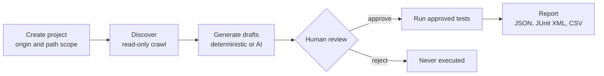
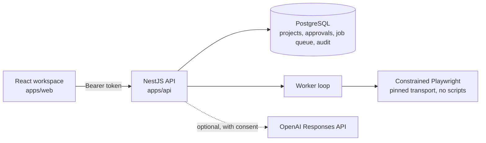

# Sentinel — AI Autonomous Testing Agent


[](https://github.com/rajuerladinny/ai-autonomous-testing-agent/actions/workflows/ci.yml)


A human-supervised web testing workspace. Sentinel discovers the pages of a site you are authorized to test, drafts smoke tests from what it actually saw, and runs only the tests a person has approved. Built with React, TypeScript, NestJS, PostgreSQL and Playwright.

**Live demo:** https://rajuerladinny.github.io/ai-autonomous-testing-agent/ (runs in the browser with sample data; no login)

**Status:** MVP for local evaluation. See [Current scope](#current-scope) for what it does not do yet.

## Try the demo

The workspace has a demo mode that runs entirely in the browser: sample project, simulated discovery and runs, no API, database or token.

```bash
npm ci
npm run build -w @agent/contracts
npm run dev:web
```

Open **http://127.0.0.1:5173/?demo** or choose **Explore the demo** on the sign-in screen. To host it as a static site, run `npm run build:demo` and serve `apps/web/dist`; the **Deploy demo** workflow publishes the same build to GitHub Pages.

## How it works





## What works

- Authenticated workspace with project creation, origin/path scope and ownership confirmation.
- Bounded read-only Playwright discovery: maximum 20 pages, exact same origin, path boundaries, public-IP validation, pinned DNS transport, no scripts, forms, query strings, redirects, cross-origin requests or arbitrary browser actions.
- Optional OpenAI Responses API generation with structured output, explicit data-transfer consent and independent evidence validation. No key means clearly labelled **deterministic** generation; provider failures never silently become AI success.
- A small test language: visit a discovered path and check its observed title/headings. No generated JavaScript is evaluated.
- Draft → approved/rejected decisions bound to SHA-256 of the specification and immutable discovery ID. Queued runs freeze specs and revalidate approval before execution.
- PostgreSQL job queue, crash expiry, audit history, assertion outcomes and durations.
- Review queue with status filters and search; pass-rate summary and a run trend across recent runs.
- Regression flags: each run is compared with the previous one, marking new failures and fixes.
- Cancel a queued discovery or run before the worker starts it; re-run a previous run's tests in one click; select all approved tests at once.
- Reports exported as JSON, **JUnit XML** (for CI dashboards) or CSV.
- In-browser demo mode with sample data, for showing the workflow without a backend.
- Responsive React workspace with an error boundary, request timeouts and background-tab polling pause.
- CI on every push and pull request: build, unit, workflow, browser and end-to-end tests, secret scan and dependency audit.

## Run locally

Requirements: Node.js 22 or newer, npm, Docker with Compose (or PostgreSQL 17), and Linux/macOS/Windows browser dependencies supported by Playwright.

```bash
npm ci
node scripts/setup-env.mjs
docker compose up -d db
npm run install:browser
npm run build
npm run dev:api
```

In a second terminal:

```bash
npm run dev:web
```

Open **http://127.0.0.1:5173**. Read `ADMIN_TOKEN` from your local `.env` and enter it into the workspace. Do not send it to anyone. The UI retains it only in memory, so locking or reloading clears it.

Create a project using a public **staging/test** origin, approve only safe path prefixes, and confirm authorization. Start discovery; generate drafts from completed evidence; inspect each full specification; approve individual tests; select approved tests; run; inspect/export a report.

`/` permits all otherwise allowed paths on that origin. Prefer narrow prefixes such as `/help` or `/docs`. The origin must be the final non-redirecting URL, without a path, custom port, credentials or query. The worker uses a Chromium sandbox by default. Run under an unprivileged OS user with a working sandbox, rather than disabling it for real targets.

The development API binds to loopback by default. The Vite dev server proxies API requests. For hosted use, serve the built frontend behind an authenticated HTTPS reverse proxy and deploy the worker with enforced network isolation; this repository does not claim a production multi-tenant deployment.

### Optional AI generation

Set `OPENAI_API_KEY` and an explicitly chosen supported `OPENAI_MODEL` in `.env` **on the API server only**, then restart the API. Never use a `VITE_` variable for a key. The browser asks for consent before generation sends paths, titles and headings to OpenAI. Common email, long-number and token patterns are redacted before storage, but this is not a complete data-loss prevention system. Use synthetic test data.

No live AI account or paid request is required for local deterministic generation or CI. The API integration is tested with mocked provider responses; a live provider smoke test requires your own local key and model.

## Verify

```bash
npm run build
npm test
npm run check:secrets
```

Build before tests: the HTTP tests load compiled NestJS decorators. Database workflow tests use **PGlite, the PostgreSQL engine compiled to WASM**, including real constraints, SQL transactions and queue queries; they do not connect to a remote PostgreSQL service. Chromium tests use synthetic pages supplied through the same browser routing gate, with no requests to third-party applications. The UI end-to-end test uses the real React UI, NestJS API, PostgreSQL engine and constrained browser, with deterministic generation.

The source scan checks recognizable key/private-key patterns; it is not proof that no possible secret exists. `.env`, keys, artifacts and dependencies are ignored. `setup-env.mjs` creates fresh random local credentials and refuses to overwrite an existing file.

## Layout

| Path                        | Purpose                                                       |
| --------------------------- | ------------------------------------------------------------- |
| `apps/web`                  | React workspace, review flow, reports                         |
| `apps/web/src/lib`          | API client, demo backend, report exports (unit tested)        |
| `apps/api/src/app.ts`       | NestJS endpoints, bearer auth, validation errors, rate limits |
| `apps/api/src/service.ts`   | Approval state machine, transactions, queue, audit            |
| `apps/api/src/browser.ts`   | Constrained Playwright discovery/execution                    |
| `apps/api/src/safety.ts`    | URL policy, IP checks, pinned transport, approval hashes      |
| `apps/api/src/generator.ts` | Evidence-backed deterministic/AI generation                   |
| `apps/api/src/schema.ts`    | Version 1 PostgreSQL schema and indexes                       |
| `packages/contracts`        | Shared validated request and test schemas                     |
| `docs/API.md`               | Request/response contracts                                    |
| `docs/ARCHITECTURE.md`      | Data model, jobs, state transitions and roadmap               |
| `docs/SECURITY.md`          | Implemented controls and practical limits                     |

## Current scope

This release covers **unauthenticated, server-rendered, read-only smoke tests**. It does not test React-only client-rendered target screens, login flows, clicks, form validation, payments or destructive journeys. Those require a separately designed interaction policy, synthetic accounts, isolated browser workers and a more detailed approval model. Missing requirements can still produce missing tests: discovered headings/titles are evidence of the current UI, not a statement of intended business behavior.

Full regression assurance, screenshot/trace storage, schedules, secrets vaults, team RBAC, cancellation of running jobs and retention controls are future work. The current single-admin token is for local evaluation.
