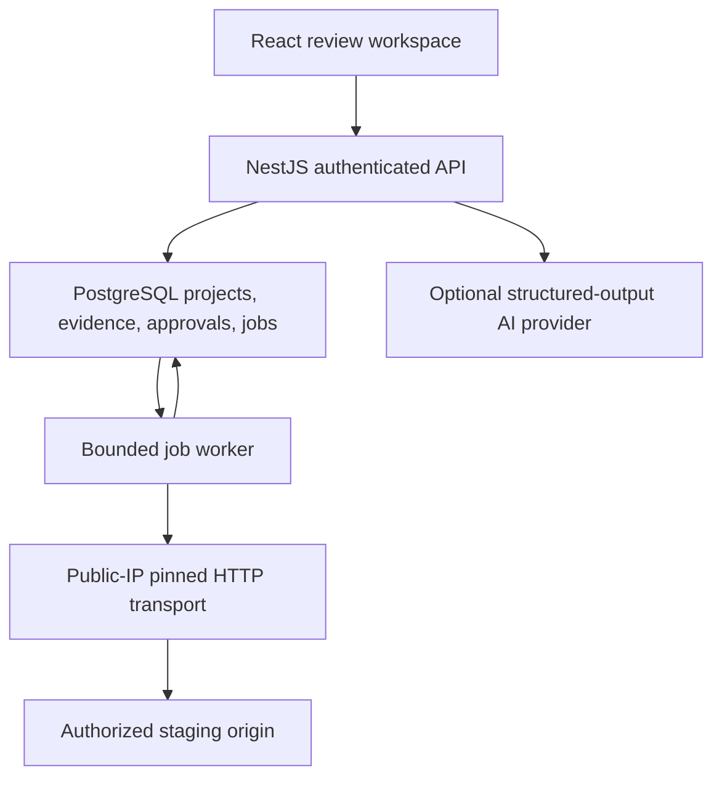

# Architecture and development roadmap

## Components

The API process polls durable jobs every 500 ms, with one active browser job per process. Discovery and execution are asynchronous; generation is bounded and synchronous. `FOR UPDATE SKIP LOCKED` claims queued jobs transactionally; per-project row locking prevents duplicate active discoveries and runs. A queued entity and its job are inserted together, preventing an unqueued orphan on transaction failure. Work completes within a three-minute browser deadline. Jobs running over ten minutes are failed without automatic replay. Operators can queue new work after a crash.

Projects and discovery snapshots are immutable through the API. Generated specs and final approval decisions cannot be edited. A new generation produces new drafts and new approvals. The API verifies digest and status at approval, enqueue and execution; run snapshots preserve the exact approved specification.

## State transitions

| Entity        | Permitted transitions                           |
| ------------- | ----------------------------------------------- |
| Discovery/job | QUEUED → RUNNING → SUCCEEDED or FAILED          |
| Test          | DRAFT → APPROVED or REJECTED; terminal decision |
| Run           | QUEUED → RUNNING → SUCCEEDED or FAILED          |

Run `SUCCEEDED` means the job completed and results were saved; individual assertions may still fail. Report passed/failed counts express test outcomes. `FAILED` means infrastructure, policy or approval failure prevented a complete run. Job failure must never be read as a passing test result.

## Data model

| Table           | Important fields and relationships                                                     |
| --------------- | -------------------------------------------------------------------------------------- |
| projects        | UUID, origin, path prefixes, page cap, authorization confirmation                      |
| discoveries     | Project FK, status, immutable path/title/heading/link evidence, blocked count          |
| test_cases      | Project/discovery FKs, validated JSON spec, digest, source, status, approval timestamp |
| runs            | Project FK, job status, assertion results, durations, failure reason                   |
| run_tests       | Run/test composite key, frozen spec and approved digest                                |
| jobs            | Kind, entity ID, state, claim/completion timestamps                                    |
| audit_events    | Action, entity ID, single-admin actor, minimal details, timestamp                      |
| schema_versions | Applied migration number                                                               |

Migrations execute in a transaction with a PostgreSQL advisory lock during startup. Version 1 is idempotent. Future schema changes should be separate numbered migrations, not alterations to already-applied SQL. PostgreSQL credentials are supplied locally through environment configuration.

## Discovery and test coverage

1. An admin confirms permission and chooses a public origin, safe path prefixes and page budget.
2. The worker loads only top-level HTML documents, with scripts and all subresources blocked.
3. Allowed links are followed breadth-first. Unreadable pages are skipped; zero readable pages fails the job.
4. Stored evidence contains capped, pattern-redacted titles/headings and safe paths; no input values, cookies or session storage.
5. Deterministic or explicitly authorized AI generation proposes only observed expectations.
6. Human approval binds the whole spec to its discovery snapshot.
7. An approved run navigates each path and evaluates fixed title/heading assertions.
8. A report retains per-test outcomes and the approval digest used.

These are change-detection smoke tests. A discovered defect may become an observed baseline, so humans must judge whether the expectation is correct. Business requirements and manually specified acceptance criteria are a later independent input channel.

## Roadmap

| Phase             | Deliverable                                                                                           | Exit criterion                                                          |
| ----------------- | ----------------------------------------------------------------------------------------------------- | ----------------------------------------------------------------------- |
| Initial MVP       | This read-only, approved smoke workflow                                                               | Build, policy, SQL, API and Chromium/UI tests pass                      |
| Interaction pilot | Synthetic login sessions, click/fill DSL, explicit action-level risk classification                   | Negative tests prove no action executes outside approved policy         |
| Worker isolation  | Separate worker service, egress enforcement, container limits, durable artifact storage, cancellation | Browser compromise cannot access API/DB credentials or private networks |
| Team pilot        | User identity, project RBAC, approval separation, retention/deletion, provider budget controls        | Cross-user/project authorization and audit tests pass                   |
| Product release   | Requirement import, user-maintained assertions, schedules, CI integrations, billing                   | Measured coverage, reliability, security and customer acceptance        |

Do not remove the approval gate or enable arbitrary generated scripts to expand coverage. Extend the DSL and policies together, with evidence and meaningful negative tests.
